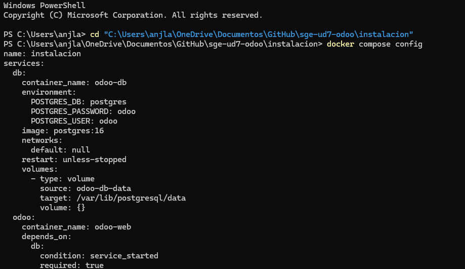
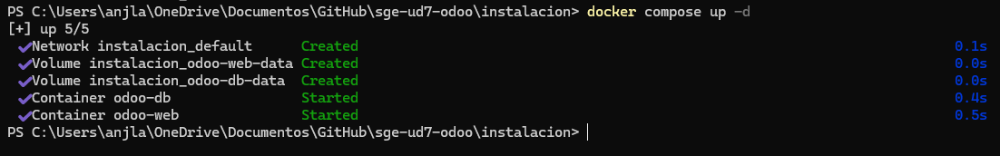
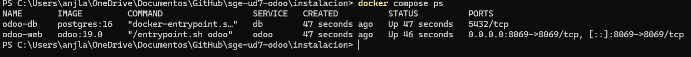
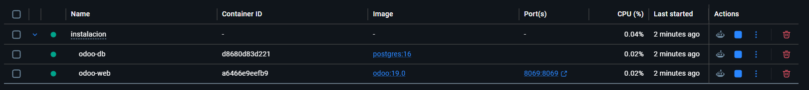
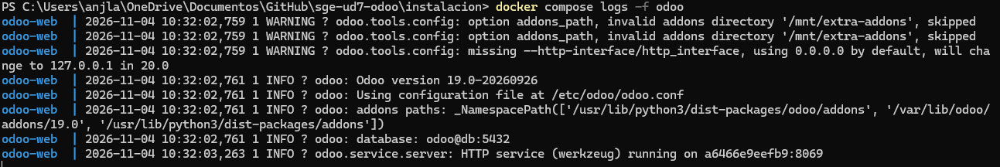
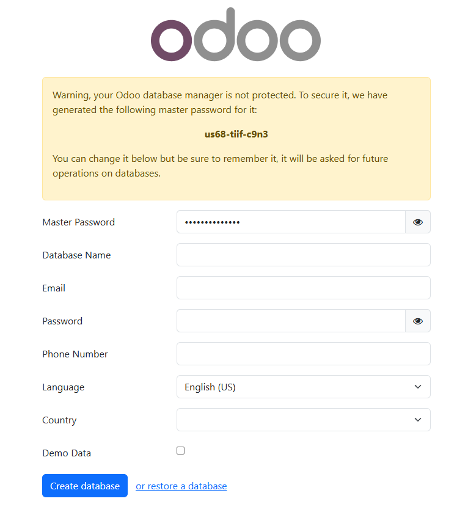

# Instalación de Odoo 19.0 con Docker

## Versión y edición

- Odoo **19.0**, edición **Community**.

## Tipo de instalación y justificación

- Instalación con **Docker Desktop** en Windows, usando dos contenedores:
  - `odoo-web`: imagen `odoo:19.0`, puerto 8069.
  - `odoo-db`: imagen `postgres:16`, base de datos.
- Instalaremos en Docker ya que al querer trabajar este servidor desde diferentes equipos, Docker es capaz de hacer una máquina virtual de Linux en la que luego la instalación será fácil cuando cambiemos de equipo.

## Requisitos

- Windows 11.
- Docker Desktop instalado y en marcha. Versión del motor usada: 29.8.0.
- Conexión a internet para descargar las imágenes la primera vez.
- Puerto 8069 libre en el equipo.

## Pasos

### 1. Carpeta de la instalación

El archivo de configuración está en `instalacion/docker-compose.yml` dentro del repositorio. Desde PowerShell, entra en esa carpeta:

```powershell
cd "C:\Users\anjla\OneDrive\Documentos\GitHub\sge-ud7-odoo\instalacion"
```

### 2. Comprobar el archivo de configuración

```powershell
docker compose config
```

Si no muestra errores, el archivo es correcto.



### 3. Levantar los contenedores

```powershell
docker compose up -d
```

La primera vez descarga las imágenes, así que puede tardar varios minutos.



### 4. Comprobar que están funcionando

```powershell
docker compose ps
```

Las dos filas deben aparecer con estado `running`.





### 5. Revisar el arranque de Odoo (opcional)

```powershell
docker compose logs -f odoo
```

Para dejar de ver el registro, pulsa `Ctrl+C`. Esto no detiene el contenedor.



### 6. Abrir Odoo en el navegador

Entra en `http://localhost:8069`.



Las credenciales de la base de datos están en `docker-compose.yml`, en el servicio `db`.

## Puerto y URL

- Puerto del contenedor `odoo-web`: `8069`.
- URL de acceso: `http://localhost:8069`.